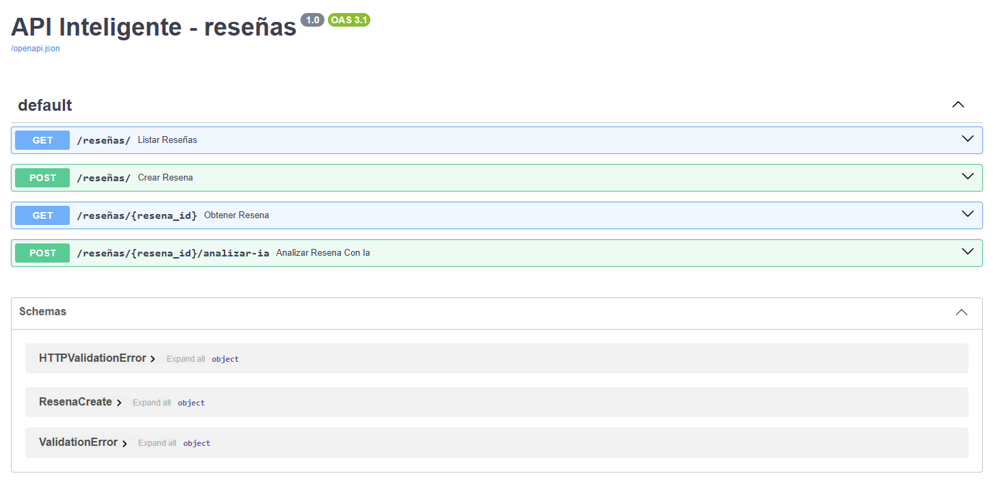

# API Inteligente de Reseñas de Negocios Locales

## Descripción del Problema
Este proyecto consiste en el desarrollo del backend de una aplicación con Python utilizando **FastAPI** y **SQLite**. La API permite gestionar un sistema completo de reseñas de clientes (CRUD) para un negocio local, e incorpora un **endpoint inteligente potenciado por IA** que analiza el sentimiento de los comentarios y genera resúmenes automáticos.

---

## Requisitos Técnicos Implementados
1. **API con FastAPI**: CRUD completo implementado (`POST`, `GET`, `GET by id`, `PUT`, `DELETE`).
2. **Modelos Pydantic**: Validación estricta de datos (longitud mínima de texto, calificaciones en rangos de 1 a 5).
3. **Base de Datos SQLite**: Persistencia local de los datos utilizando `sqlite3`.
4. **Endpoint Inteligente (IA)**: Análisis automatizado de reseñas para detectar sentimientos y generar resúmenes.
5. **Seguridad**: Uso de variables de entorno mediante un archivo `.env` para proteger credenciales y claves de API.

---

## Cómo Instalar y Ejecutar el Proyecto

1. **Clona el repositorio** o descarga los archivos en tu computadora.
2. **Crea un archivo `.env`** en la raíz del proyecto basándote en el archivo `.env.example` y añade tu clave de API.
3. **Instala las dependencias necesarias** ejecutando en tu terminal:
   ```bash
   pip install fastapi uvicorn pydantic python-dotenv
   
   Inicia el servidor local: uvicorn main:app --reload

   API: http://127.0.0.1:8000/docs

  
