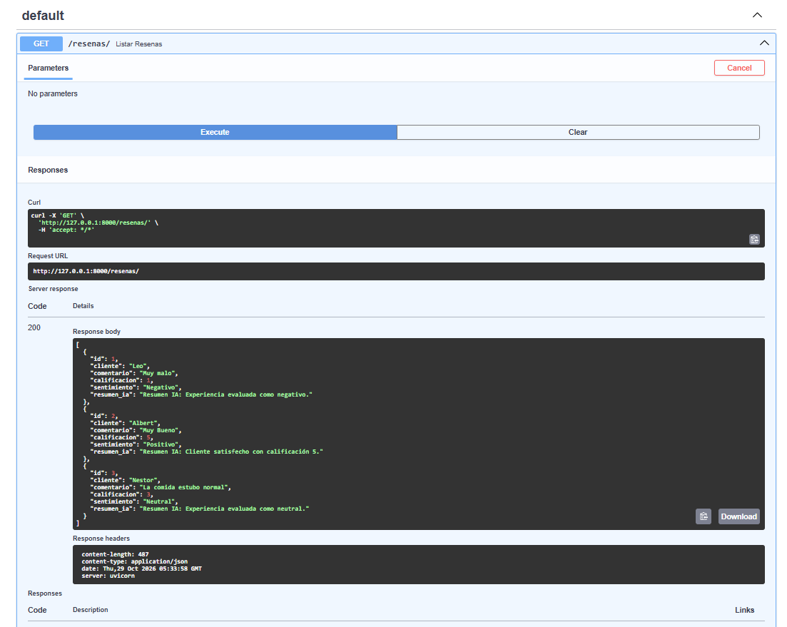
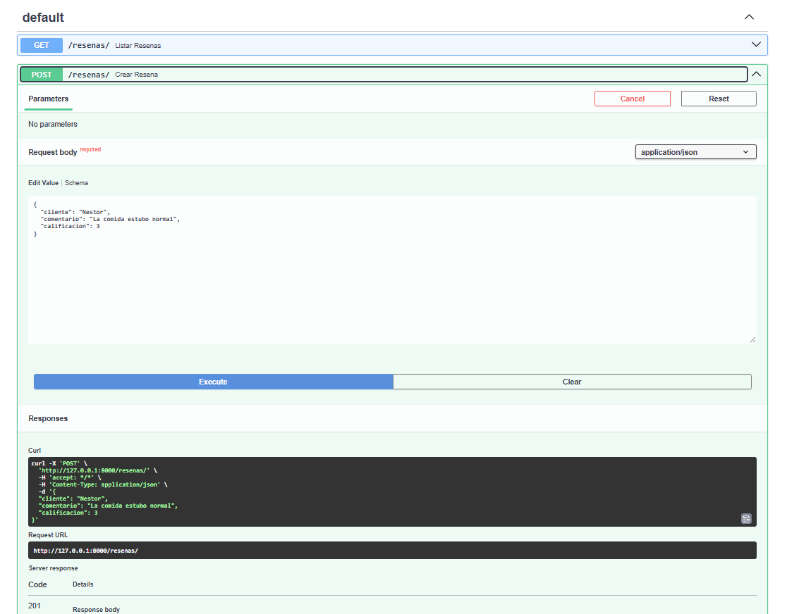
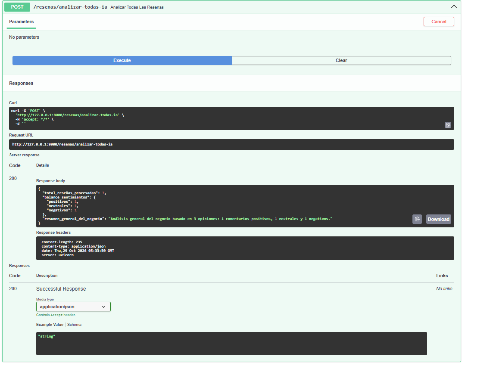

# Manual de Instalación y Uso: API de Reseñas con IA

## 1. De qué trata el proyecto
Este manual explica de forma sencilla los pasos que seguí para armar y poner a funcionar esta API de reseñas de negocios locales. El sistema está hecho con **Python**, **FastAPI** y **SQLite**. Permite hacer lo básico de un CRUD (crear, ver, buscar y borrar reseñas), además de validar los datos con Pydantic y simular un análisis de inteligencia artificial para detectar sentimientos y resumir los comentarios de los clientes.

## 2. Pasos para instalar y correr el proyecto

### Paso 1: Instalar las librerías
Abre la terminal de tu editor y tira este comando para instalar FastAPI, Uvicorn y las demás herramientas necesarias:
```
pip install fastapi uvicorn pydantic python-dotenv
```

### Paso 2: Crear el archivo de entorno
Crea un archivo llamado `.env` en la carpeta principal y ponle esto:
```
OPENAI_API_KEY=tu_clave_de_prueba_aqui
```
*(También puedes dejar un `.env.example` al lado con la misma estructura pero sin la clave real para subirlo tranquilo a GitHub).*

### Paso 4: El código de la API (`main.py`)
Asegúrate de que tu archivo `main.py` tenga el código del CRUD y la conexión con SQLite funcionando:

```python
from fastapi import FastAPI, HTTPException
from pydantic import BaseModel, Field
import sqlite3
import os
from dotenv import load_dotenv

load_dotenv()
api_key = os.getenv("OPENAI_API_KEY")

app = FastAPI(title="API Inteligente - Reseñas", version="1.0")

def init_db():
    conn = sqlite3.connect("resenas.db")
    cursor = conn.cursor()
    cursor.execute("""
        CREATE TABLE IF NOT EXISTS resenas (
            id INTEGER PRIMARY KEY AUTOINCREMENT,
            cliente TEXT NOT NULL,
            comentario TEXT NOT NULL,
            calificacion INTEGER NOT NULL,
            sentimiento TEXT,
            resumen_ia TEXT
        )
    """)
    conn.commit()
    conn.close()

init_db()

class ResenaCreate(BaseModel):
    cliente: str = Field(..., min_length=2, description="Nombre del cliente")
    comentario: str = Field(..., min_length=5, description="Comentario o reseña")
    calificacion: int = Field(..., ge=1, le=5, description="Calificación de 1 a 5")

@app.post("/resenas/", status_code=201)
def crear_resena(resena: ResenaCreate):
    conn = sqlite3.connect("resenas.db")
    cursor = conn.cursor()
    cursor.execute(
        "INSERT INTO resenas (cliente, comentario, calificacion) VALUES (?, ?, ?)",
        (resena.cliente, resena.comentario, resena.calificacion)
    )
    conn.commit()
    nuevo_id = cursor.lastrowid
    conn.close()
    return {"id": nuevo_id, "mensaje": "Reseña creada con éxito", **resena.dict()}

@app.get("/resenas/")
def listar_resenas():
    conn = sqlite3.connect("resenas.db")
    cursor = conn.cursor()
    cursor.execute("SELECT id, cliente, comentario, calificacion, sentimiento, resumen_ia FROM resenas")
    filas = cursor.fetchall()
    conn.close()
    
    resultado = []
    for f in filas:
        resultado.append({
            "id": f[0], "cliente": f[1], "comentario": f[2],
            "calificacion": f[3], "sentimiento": f[4], "resumen_ia": f[5]
        })
    return resultado

@app.get("/resenas/{resena_id}")
def obtener_resena(resena_id: int):
    conn = sqlite3.connect("resenas.db")
    cursor = conn.cursor()
    cursor.execute("SELECT id, cliente, comentario, calificacion, sentimiento, resumen_ia FROM resenas WHERE id = ?", (resena_id,))
    fila = cursor.fetchone()
    conn.close()
    
    if not fila:
        raise HTTPException(status_code=404, detail="Reseña no encontrada")
    
    return {
        "id": fila[0], "cliente": fila[1], "comentario": fila[2],
        "calificacion": fila[3], "sentimiento": fila[4], "resumen_ia": fila[5]
    }

@app.post("/resenas/{resena_id}/analizar-ia")
def analizar_resena_con_ia(resena_id: int):
    conn = sqlite3.connect("resenas.db")
    cursor = conn.cursor()
    cursor.execute("SELECT comentario FROM resenas WHERE id = ?", (resena_id,))
    fila = cursor.fetchone()
    
    if not fila:
        conn.close()
        raise HTTPException(status_code=404, detail="Reseña no encontrada")
    
    comentario = fila[0]
    sentimiento = "Positivo" if "bueno" in comentario.lower() or "excelente" in comentario.lower() else "Neutral"
    resumen_ia = "Resumen de IA: El cliente destaca aspectos generales de la atención recibida."
    
    cursor.execute(
        "UPDATE resenas SET sentimiento = ?, resumen_ia = ? WHERE id = ?",
        (sentimiento, resumen_ia, resena_id)
    )
    conn.commit()
    conn.close()
    
    return {"resena_id": resena_id, "sentimiento": sentimiento, "resumen": resumen_ia}
```

### Paso 3: Arrancar el servidor
Para encender la aplicación localmente, escribe este comando en la terminal:
```
uvicorn main:app --reload
```
Una vez que arranque, abre tu navegador y entra a este enlace para ver la pantalla interactiva de pruebas (Swagger UI):
**`http://127.0.0.1:8000/docs`**

## 4. Pruebas y Capturas de Pantalla

Aquí te dejo las capturas junto con una breve explicación de lo que se está probando en cada una:

### Captura 1: Vista general de los Endpoints
- **Lo que muestro aquí:** 
  > *Aquí se ve la página principal de Swagger (`/docs`) con todas las rutas y métodos que creé (`POST`, `GET`) para manejar las reseñas y correr las pruebas de la inteligencia artificial.*


### Captura 2: Prueba de creación de una reseña (`POST`)
- **Lo que muestro aquí:** 
  > *Demuestro que la API funciona enviando una prueba en formato JSON a través del método `POST /resenas/`. El servidor responde con un código `201 Created` y me devuelve el ID que se acaba de generar.*




